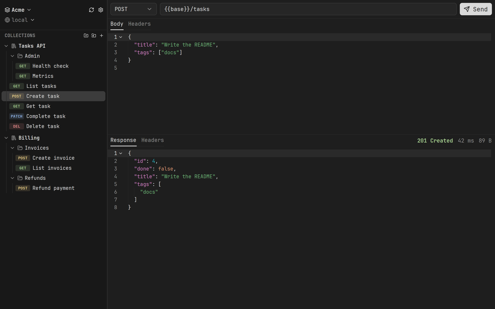
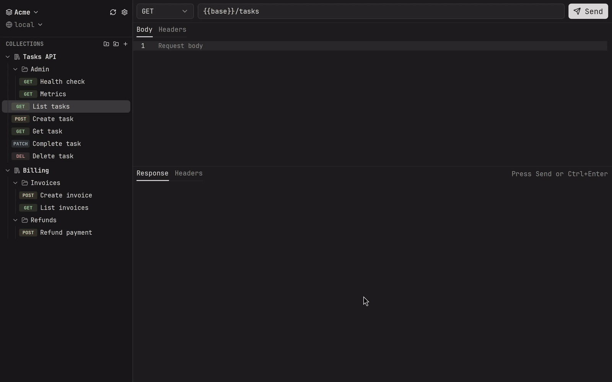
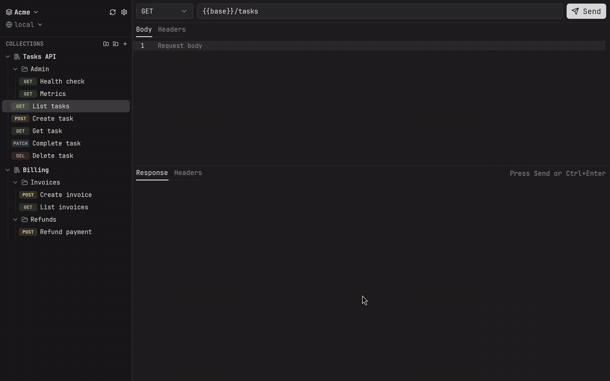
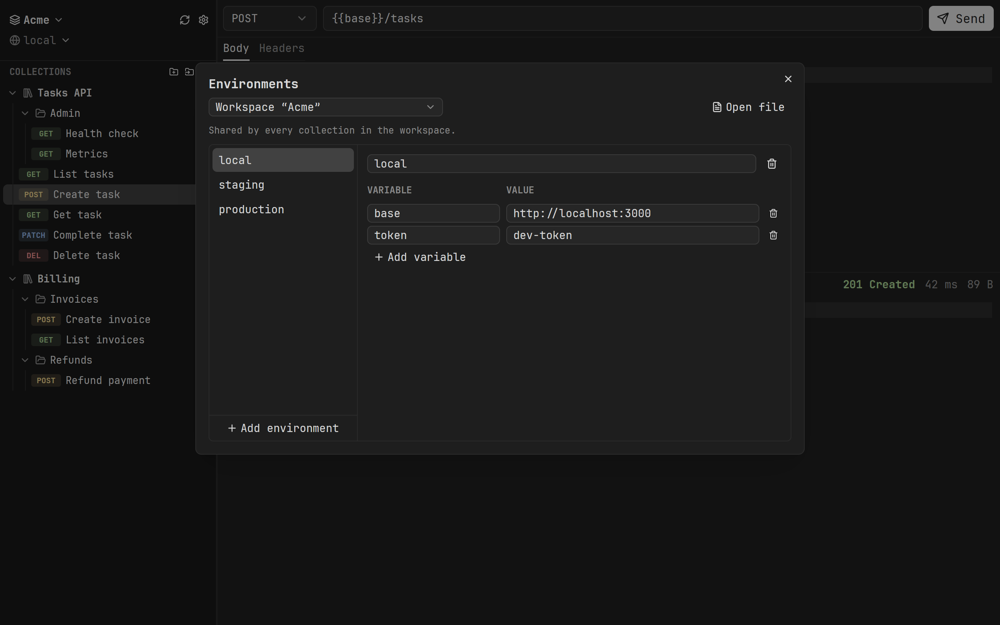

# reqo

A fast native HTTP client built on [GPUI Kit](https://github.com/longbridge/gpui-kit).
Requests are plain files, so collections live happily in git next to your code.



```sh
cargo run                        # open the last workspace
cargo run -- examples/requests   # add a folder to it as a collection and open it
```

## Sending requests

Pick a request, press **Send** or Ctrl+Enter, and the response shows up with its
status, timing, size and highlighted body. Edits are saved as you go. The
Headers tab also lists what goes out on top of the request's own headers: those
of its collection and the ones reqo adds.



## Workspaces and collections

A **workspace** holds **collections**, and a collection holds
requests, optionally grouped in folders. Switch, create and rename workspaces
from the menu at the top of the sidebar.

Everything is plain files. Workspaces live in `~/.local/share/reqo`
(`$XDG_DATA_HOME/reqo`):

```text
workspaces/<name>/
    workspace.toml        name and the list of collections
    reqo.env.toml         environments shared by all collections
    collections/<name>/   collections created in the app
```

A collection can also be any folder on disk, such as one inside a project's
repository: add it with the folder button in the sidebar, or pass it on the
command line. Removing such a collection from the workspace leaves the folder
alone.

Drag requests and folders to move them, also into another collection. Hover a
collection or folder for buttons that add a request or a subfolder, or
right-click for more.



## Files

A collection is a folder. Every `*.req.toml` inside it is a request, and
subfolders show up as folders in the sidebar:

```toml
name = "Create user"
method = "POST"
url = "{{base}}/users"
body = """
{ "name": "vasya" }
"""

[headers]
X-Request-Id = "docs-1"
```

Environments live in `reqo.env.toml`; `{{name}}` is substituted in the URL,
headers and body:

```toml
[dev]
base = "http://localhost:8080"
```

The workspace's file applies to every collection. A collection can have its own
`reqo.env.toml` at its root: its environments are added to the workspace's, and
its variables override those of the environment with the same name.

Edit both in the app: *Manage environments…* in the environment picker under the
workspace name, or *Edit environments* in the workspace and collection menus. Changes are saved as you
type; comments in the files are not kept.



### Headers

Headers every request of a collection needs, like a token, go into
`reqo.collection.toml` at the collection's root, edited with *Edit headers* in
its menu:

```toml
[headers]
Authorization = "Bearer {{token}}"
```

A request's own header of the same name wins. On top of that, reqo sends
`User-Agent` and `Accept: */*`, and `Content-Type: application/json` when the
body is JSON, unless the request or its collection sets them.

## Look

Pick light and dark themes in Settings (Ctrl+,), or let the mode follow the
desktop. The UI uses the desktop's monospace font as fontconfig reports it, so
on Omarchy it matches the rest of the system.

## Keys

| Key          | Action                  |
| ------------ | ----------------------- |
| Ctrl+Enter   | Send                    |
| Ctrl+S       | Save                    |
| Ctrl+N       | New request             |
| Ctrl+R       | Reload files from disk  |
| Ctrl+,       | Settings                |
| Ctrl+Shift+T | Toggle light/dark mode  |
| F2           | Rename request          |
| Delete       | Delete request          |

Edits are saved automatically when you send or switch requests.

## Layout

- `crates/reqo-core` — file format, workspaces, environments, request execution (no UI)
- `crates/reqo` — the GPUI app
